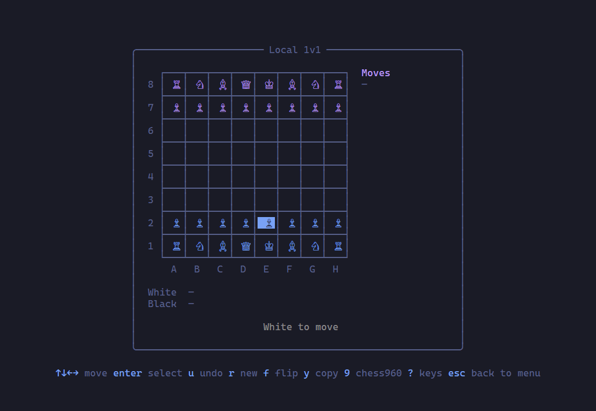
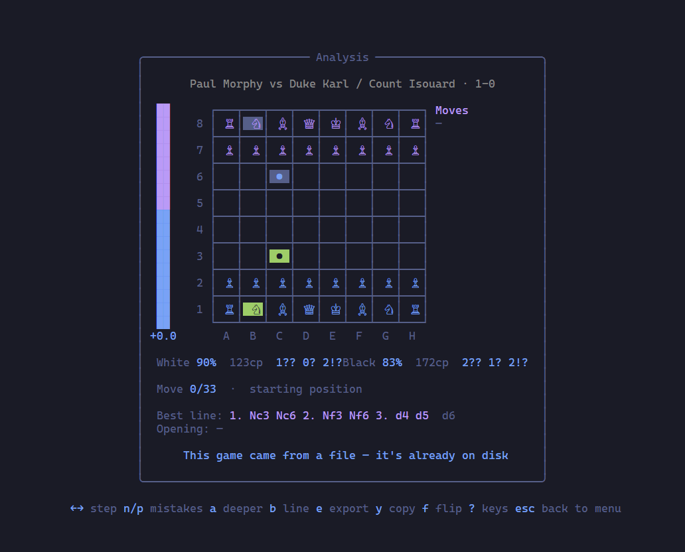
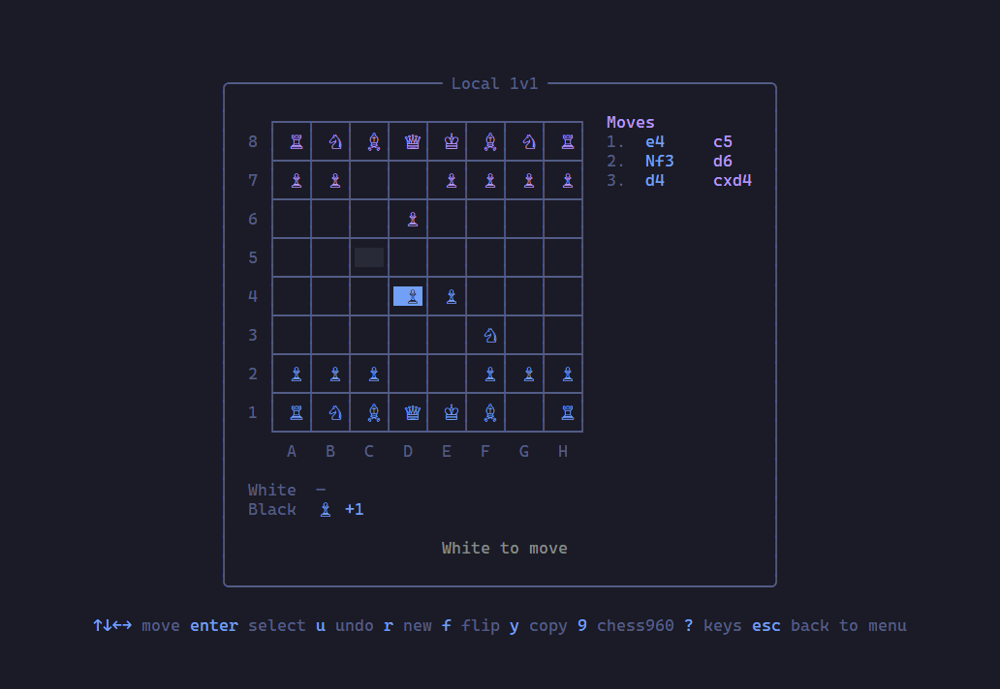
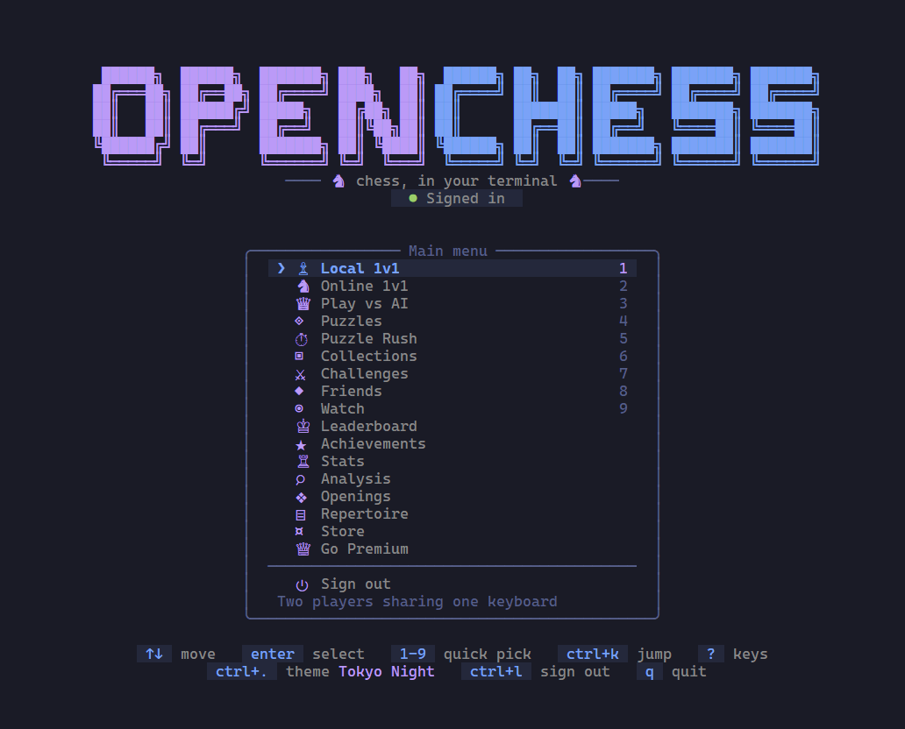
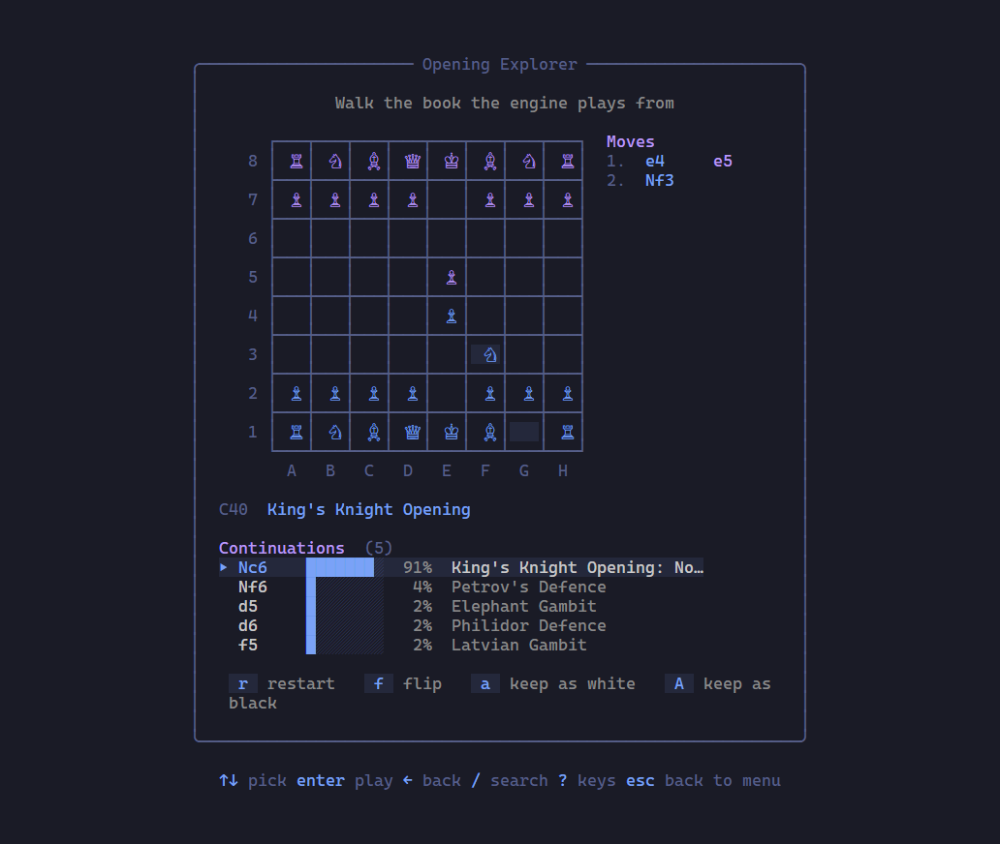
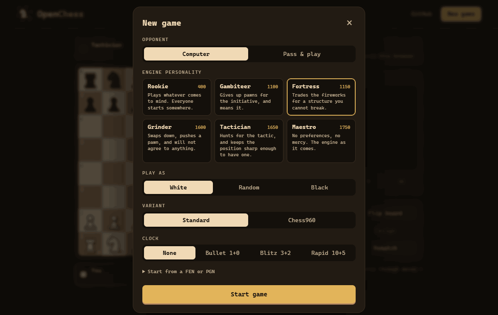

<h1 align="center">
  <picture>
    <source media="(prefers-color-scheme: dark)" srcset="assets/logo-wordmark-dark.svg">
    
  </picture>
</h1>

<p align="center">Chess, in your terminal.</p>

<p align="center">
  <a href="https://github.com/HilthonTT/OpenChess/actions/workflows/ci.yml"></a>
  <a href="https://bun.sh"></a>
  <a href="https://www.typescriptlang.org"></a>
  <a href="https://github.com/sst/opentui"></a>
  <a href="https://hono.dev"></a>
  <a href="https://www.prisma.io"></a>
  <a href="LICENSE"></a>
</p>

<p align="center">
  
</p>

A TUI chess game with a full progression system behind it: play locally, against
six engine personalities, or online; train tactics and openings; review games with
an engine; earn XP, coins, achievements and titles — without leaving the terminal.

**[Play in the browser →](https://hilthontt.github.io/OpenChess/)** A static build
of the same engine (pass and play or any of the bots, with clocks and Chess960),
running in a Web Worker with no backend.

## Demo

| Review a game with the engine | 30+ themes |
| --- | --- |
|  |  |
| **The menu** | **Opening explorer** |
|  |  |
| **The web app** | **Six bots, clocks, Chess960** |
|  |  |

## Features

- **Play** — local 1v1, six bots with their own style and opening book, or ranked
  online games from a matchmaking queue, with premoves, draw offers, takebacks and
  bullet/blitz/rapid clocks. Chess960 throughout.
- **Social** — challenges by name or code, friends with presence, profiles with a
  rating curve, spectating with a gallery chat, nine set phrases instead of free text.
- **Train** — a puzzle ladder with its own Elo, daily puzzle, Puzzle Rush, motif
  collections, an opening explorer, and a spaced-repetition repertoire drill.
- **Review** — eval bar, per-side accuracy, a verdict per move, opening names, jumps
  between mistakes, PGN/FEN in and out.
- **Progression** — XP, coins, achievements, streaks, a leaderboard, and a store of
  titles to wear.
- **Terminal-native** — `ctrl+k` goes to any screen, `?` shows the keys, clipboard and
  bell work over SSH, 30+ themes.

## Install

Grab a standalone binary for Linux, macOS or Windows from the
[latest release](https://github.com/HilthonTT/OpenChess/releases/latest) — no Bun
needed — and run `openchess`. Local play and `--fen` / `--pgn` analysis work offline;
everything with an account talks to the API at `API_URL`.

```sh
openchess                  # the menu
openchess puzzles          # straight to a screen
openchess --pgn game.pgn   # review a game, no account needed
openchess --theme nord     # pick a theme for this session
```

Pieces look clipped? Your font has no chess glyphs — use `--pieces letters`.
Flags and every screen's keys: **[docs/playing.md](docs/playing.md)**.

## Development

Needs [Bun](https://bun.sh) 1.3+ (and PostgreSQL for the server).

```sh
bun install
bun run dev:cli      # the game
bun run dev:web      # the browser build
bun run dev:server   # the API — see docs/server.md for env and database setup
bun test && bun run typecheck && bun run lint
```

| Package | |
| --- | --- |
| [`cli`](packages/cli) | The game — an [OpenTUI](https://github.com/sst/opentui) React app |
| [`web`](packages/web) | The browser build — Next.js, static export |
| [`server`](packages/server) | The HTTP API — [Hono](https://hono.dev) with OpenAPI docs |
| [`database`](packages/database) | The [Prisma](https://www.prisma.io) schema and client, on PostgreSQL |
| [`shared`](packages/shared) | The chess engine, the progression rules, the chat catalog |

- **[docs/server.md](docs/server.md)** — environment variables, migrations, importing
  the Lichess puzzle database, the live-game event stream, API error format.
- **[DESIGN.md](DESIGN.md)** — the parts where the obvious implementation is the
  wrong one: presence without a connection, castling on a shuffled back rank, six
  bots out of one engine, and more.
- **[CONTRIBUTING.md](CONTRIBUTING.md)** · [Code of Conduct](CODE_OF_CONDUCT.md) ·
  [Security policy](SECURITY.md)

The engine is verified with [perft](https://www.chessprogramming.org/Perft); search is
alpha-beta negamax with a quiescence search past the horizon.

## License

[MIT](LICENSE)
